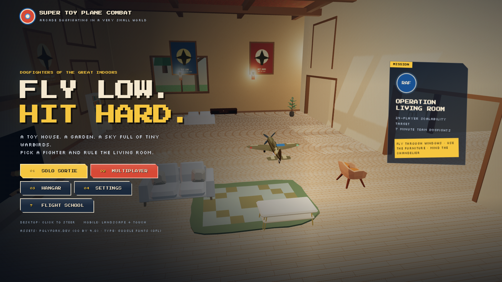
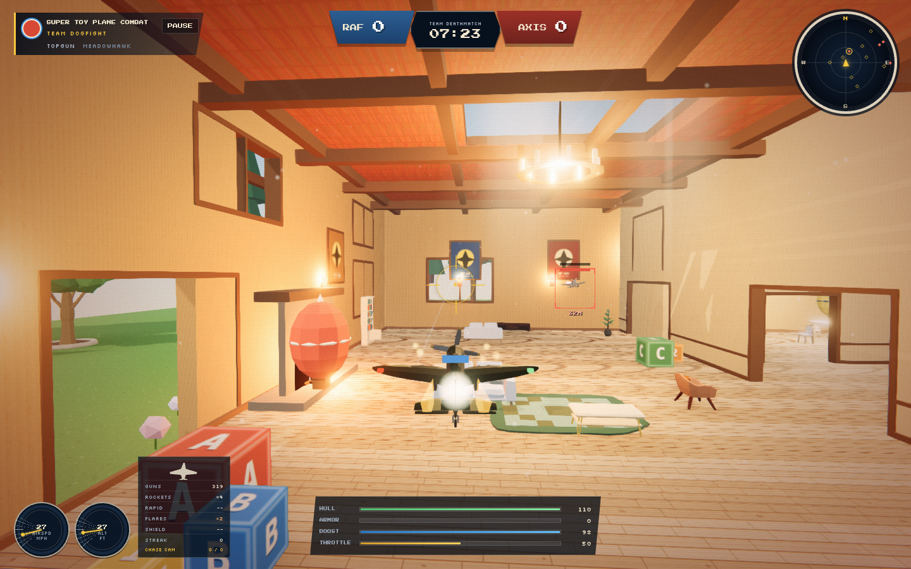

# Super Toy Plane Combat

A complete, playable 3D arcade dogfighting game set in a giant low-poly toy house and garden. Fly miniature WWII-inspired fighters through doorways, windows, under furniture, down hallways, up the stairs and out into the garden. Built with Three.js, TypeScript, Vite, Rapier and Colyseus.





## Features

- **One continuous toy world:** a large multi-room house with a double-height living room, kitchen, bedrooms, hallways, stairs, skylight, collidable furniture, garden, patio, trees, hedges, fountain and a fortified toy-box boundary.
- **Arcade flight:** bank-to-turn coordination, boost, throttle, collision bounces, damage and respawning. Climbing bleeds energy and diving recovers it; heavy damage cuts top speed and turn authority, and a stalled wing drops the nose until airflow returns.
- **Combat:** twin machine-gun tracers, homing rockets, flare countermeasures, splash damage, explosions, debris physics, smoke trails, hit markers and kill feed. Kill streaks award score, rapid fire, armour, repairs and a full rocket rack; multi-kills pop callouts.
- **Destructible balloons:** ten drifting hot-air balloons can be shot down to release floating armour, hull repair, rapid-fire or energy-shield pickups. Fly through a pickup to collect it.
- **Four aircraft:** Meadowhawk, Blue Jay, Crimson Fox and Golden Wasp, each with its own speed, agility, armour, ammo and handling.
- **Two cameras:** chase camera and first-person cockpit view with cockpit framing.
- **Post-match debrief:** accuracy, damage, rocket hits, balloons popped, best streak and longest life, plus earned medals such as ACE, UNTOUCHED, BALLOON BUSTER and SHARPSHOOTER.
- **Solo play:** team deathmatch, free-for-all or three-life survival against 1–11 AI pilots with Rookie, Pilot and Ace difficulty. Survival throws escalating reinforcement waves at you until the last toy pilot is out of the box.
- **Online play:** Colyseus authoritative team deathmatch and free-for-all rooms for up to 24 players, public rooms, private rooms joined by code, matchmaking lobby, ready checks, teams, scoreboard, kill feed and radio chat.
- **Desktop controls:** keyboard + mouse, pointer lock steering, wheel throttle.
- **Mobile controls:** portrait- and landscape-ready virtual joystick, throttle slider, fire, boost, rocket, flare and camera buttons, plus chat.
- **Pixel HUD:** vector/pixel fonts, team scores, match timer, radar with hostiles, balloons and pickups, target lock, speed and altitude gauges, hull/boost/throttle bars, ammo counters and responsive touch layout.
- **Performance controls:** low / medium / high graphics quality, DPR scaling, optional shadows, reduced point lights on low, particle caps, pooled effects and low-poly geometry.
- **Procedural audio:** engine, guns, rockets, impacts, explosions and a dynamic combat score synthesized with Web Audio. No sampled audio except the menu theme. The score's intensity rises with nearby targets, damage and kill streaks.

## Quick start

Requirements: **Node.js 22 or newer** and a WebGL2-capable browser.

```bash
npm install
npm run dev
```

Open <http://localhost:5173>. The game server runs on <http://localhost:2567>; in development the client calls it directly over CORS.

For a production build served by the Node server:

```bash
npm run build
npm start
```

Open <http://localhost:2567>.

## Controls

| Action | Desktop | Mobile |
| --- | --- | --- |
| Pitch up / down | `W` / `S`, mouse up / down | Left virtual stick |
| Roll left / right | `A` / `D`, mouse left / right | Left virtual stick |
| Rudder | `Q` / `E` | — |
| Throttle | `Z` / `X`, mouse wheel | Throttle slider |
| Boost | `Shift` | BOOST button |
| Machine guns | `Space` or left mouse | FIRE button |
| Rockets | `R` or right mouse | RKT button |
| Flares | `F` | FLR button |
| Camera | `V` | VIEW button |
| Scoreboard | hold `Tab` | — |
| Chat | `T` | CHAT button |
| Pause | `Esc` | HUD pause button |
| Mute | `M` | Settings |

Click the canvas to capture the mouse for pointer-locked steering.

## Modes

### Solo

Choose team deathmatch or free-for-all, enemy count and difficulty. AI pilots have distinct personalities — aggressor, sniper, trickster and energy fighter — and they select targets, lead their shots, fire guns and rockets, break hard when hit, evade incoming missiles, call out kills on the radio, use look-ahead probes to steer around walls and furniture, recover from collisions and respawn. The player starts inside the living room; hostile fighters scramble from all around the map.

**Survival** gives you three lives and starts with a small bandit patrol. Every 30 seconds a new wave adds reinforcements, and from wave six the newcomers fly at Ace difficulty. Waves keep coming until your last life is gone. The debrief records the wave reached, time survived and score.

### Multiplayer

- Public room browser and quick match.
- Private rooms joinable by six-character code.
- Lobby with team assignment, aircraft selection and ready state. The host launches when all other pilots are ready.
- Authoritative server simulation for movement validation, damage, rockets, respawns, scores, balloon pickups and match timer.
- Optional deployment configuration with `PORT`, `MATCH_SECONDS` and `VITE_SERVER_URL`.

Quick local test of a shortened match:

```bash
MATCH_SECONDS=20 npm start
```

## Project layout

```text
shared/             deterministic world layout, colliders, aircraft stats, flight model, protocol helpers
server/             Colyseus room, authoritative simulation, room registry, HTTP API and static hosting
src/game/           renderer, environment, assets, flight view, cameras, input, effects, audio
src/game/LocalMatch.ts   offline match, weapons, damage, scoring and AI orchestration
src/game/OnlineMatch.ts  online state interpolation, local prediction and reconciliation, effects
src/net/            Colyseus client and room lifecycle
src/ui/             screens, hangar, lobby, HUD, radar, chat, scoreboard
public/models/      Polyfork CC BY 4.0 GLB models
public/fonts/       Press Start 2P and Silkscreen with OFL texts
docs/               screenshots
```

## Physics and networking notes

- The client uses **Rapier** for static house/furniture colliders, swept-sphere aircraft collision checks, camera ray casts, bullet ray casts and dynamic debris.
- The shared world layout exports one set of collider boxes used by both client and server.
- Multiplayer uses a **Colyseus room** at 30 Hz simulation and 20 Hz patch state.
- The client predicts local flight, reconciles against authoritative positions, and interpolates remote aircraft.
- Server damage and projectile logic use the shared 3-axis flight model and collision helpers; clients never send positions or damage.
- Up to 24 players per room is supported by configuration. The default room is 12 pilots for reliable matches.

## Configuration

Copy `.env.example` to `.env` if you need overrides.

| Variable | Default | Purpose |
| --- | --- | --- |
| `PORT` | `2567` | HTTP + WebSocket server port |
| `MATCH_SECONDS` | `444` | Server match duration |
| `VITE_SERVER_URL` | same origin | Absolute server URL when the client is hosted separately |

In development, when the client runs on ports 5173/5174, the client automatically targets `http://<hostname>:2567`.

## Quality and testing

```bash
npm run typecheck
npm run build
```

The repository builds cleanly with TypeScript strict mode, unused-symbol checks, and a verified production server/client start. Assets are vendored locally, so no external CDN is required at runtime.

Known scope: multiplayer rooms do not fill empty slots with AI; solo is the AI mode. Up to 24 players is the scalability target and configurable room size; 12-player rooms are the tested default.

## Credits

Game code is MIT licensed. Third-party assets and fonts retain their own licenses:

- Low-poly 3D furniture, trees and the base fighter mesh: [Polyfork](https://polyfork.dev), CC BY 4.0. Complete per-asset credits and modification notes are in [CREDITS.md](CREDITS.md).
- Press Start 2P and Silkscreen fonts: SIL Open Font License 1.1, license texts under `public/fonts/`.
- Three.js, Rapier, Colyseus, Vite and Express are used under their respective open-source licenses; see [CREDITS.md](CREDITS.md).

The game can be played offline. Only multiplayer requires the Node server.
